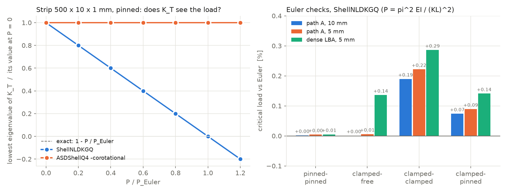
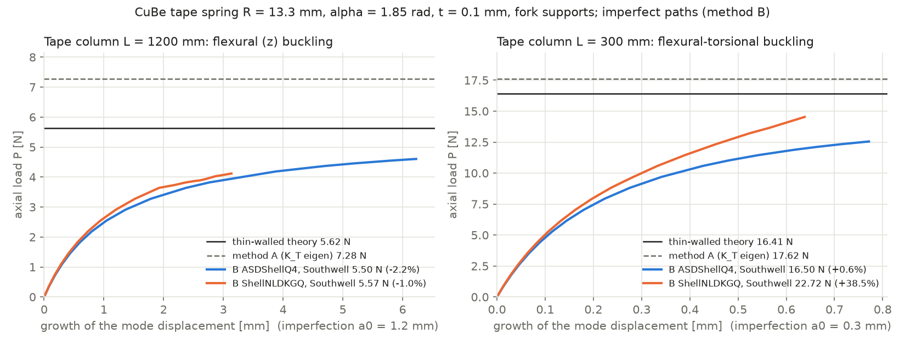
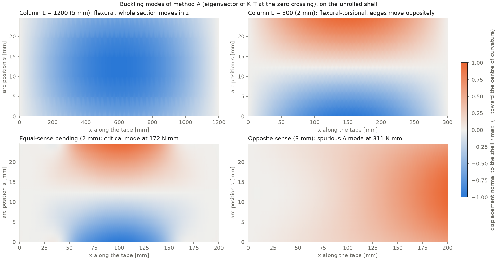
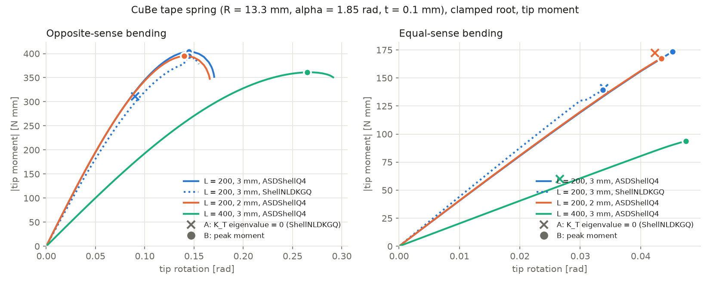
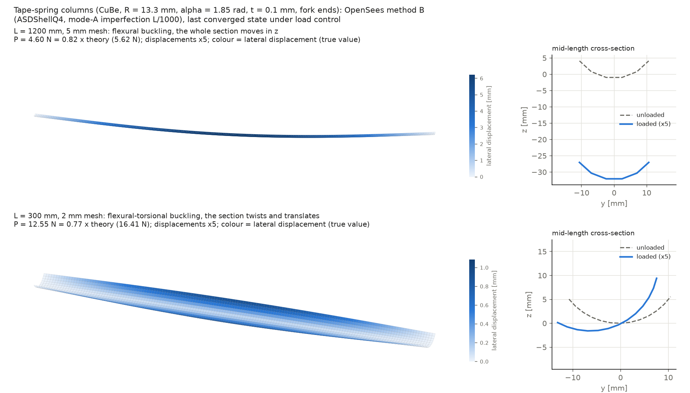
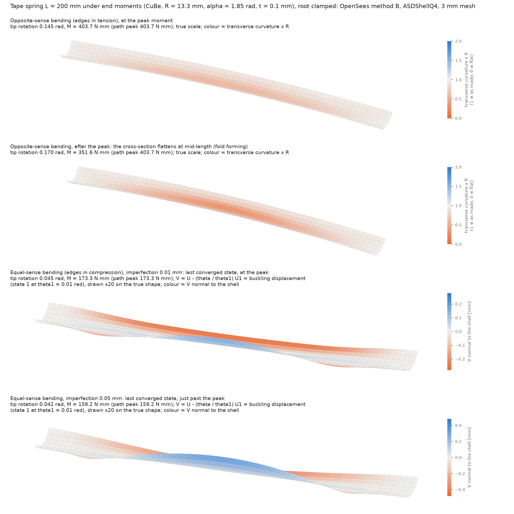

# Buckling of thin-shell coilable booms with OpenSeesPy

10/29/26, Federico (with Claude). ToDo items 7-8. Step-by-step record:
`buckling_log.txt` (this folder). Code: `.claude/skills/shell-buckling/`
(new skill) and the drivers in this folder. Units: N, mm, MPa.

## 1. Bottom line

| Question | Answer |
|---|---|
| Can OpenSeesPy do an Abaqus `*BUCKLE` (K0 + λ Kg) analysis? | Not directly. There is no buckle step and no access to Kg. The tangent K_T is only available as a dense matrix (`printA` with `FullGeneral`). |
| Can it do the "preload, then eigenvalue" check of Palmeri & Laurenzi (MDPI 2024) and Leclerc & Pellegrino (2020)? | Yes, mechanically. `eigen` after a static step gives the eigenvalues of the current K_T. But only **ShellNLDKGQ** has load-dependent (geometric) stiffness in its tangent, and that stiffness is **incomplete for curved shells**. It gives exact Euler loads for flat strips, +7% to +31% for global modes of a tape-spring column, and a spurious early crossing in opposite-sense bending. It does agree with path following, within 3%, for the equal-sense bifurcation on a 2 mm mesh. Treat it as an estimator and mode-shape generator, not as the answer. |
| What gives the buckling strength reliably? | **Path following with ASDShellQ4 -corotational** (its nonlinear residual is complete; checked against thin-walled theory to within −2.2% / +0.6% / +3%), with an imperfection seeded from the method A mode. The peak of the load path is the buckling strength (Riks-type, as in Leclerc & Pellegrino 2020 and Bessa & Pellegrino 2018). For bifurcations with a stable post-buckling path, use a Southwell plot. |
| Recommended pipeline | (A) stability scan with ShellNLDKGQ → estimate + mode; (B) imperfect path with ASDShellQ4, imperfection = mode A × (0.1-0.2 t) → buckling strength; report both, plus mesh convergence. `boom_buckling.py case.json` does A + B. |

## 2. What the literature does (survey details in the log, entry [3])

- **Palmeri & Laurenzi 2024** (Biomimetics 9:494, the MDPI paper): a CTM boom
  (two omega shells, L = 500 mm, [±45 GFPW/0 CF/±45 GFPW]), Abaqus S4R, ends
  tied by MPCs to reference points. Their "nonlinear buckling load" is found
  in three steps: (1) linear eigen buckling; (2) a load-controlled nonlinear
  static run up to that load; (3) eigen buckling about a deformed state,
  backed off until the structure is "close to but not in" post-buckling.
  Geometry is perfect. Only Pareto-front maxima are reported (Mx 11.71 N·m,
  My 10.27 N·m, F 545 N), so it is not a reproducible single benchmark.
  (MDPI blocks this machine; the paper was read from the authors'
  open-access copy.)
- **Leclerc & Pellegrino 2020** (IJSS 203:46): the same three steps, plus
  Riks with a first-mode imperfection of 0.2 t. **Bessa & Pellegrino 2018**:
  Riks with mode-combination imperfections. **Royer, Hutchinson & Pellegrino
  2022**: bifurcations along the nonlinear fundamental path, and probing.
- **Tape springs** (Seffen & Pellegrino 1999 and report TR168):
  - Opposite-sense bending: the section flattens, then snaps at
    M+max (a limit point) into a localised fold. M+max depends on L.
  - Equal-sense bending: a sudden bifurcation at |M−max| into a
    flexural-torsional mode with torsional folds near the ends. |M−max|
    does not depend on L.
  - Post-buckling fold moments: M+* = (1+ν)Dα and M−* = −(1−ν)Dα.
  - The report notes that Abaqus nonlinear runs missed the equal-sense
    bifurcation.
  - The peak values are only given in plots and empirical fits; the
    extracted text was too garbled to quote.

## 3. What OpenSeesPy 3.8 can and cannot do (verified)

| Finding | Evidence (log entry) |
|---|---|
| `eigen('-standard','-symmBandLapack', n)` gives the smallest eigenvalues of the current K_T. | Matches the dense `printA` matrix to 4 digits [2] |
| ASDShellQ4 -corotational: the tangent has **no** geometric stiffness; the residual is correct. | Strip column: K_T eigenvalues 3.031e-4 → 3.034e-4 from 0 to 0.9 P_cr, while ShellNLDKGQ goes 3.03e-4 → 3.0e-5 [2] |
| ShellNLDKGQ's geometric stiffness only covers the facet-normal displacement. | Tape column flexural mode: +31% = 1/mean(cos²φ) of the facets, mesh-converged, confirmed with fresh models [7] |
| An eigen call **changes ShellNLDKGQ's element state**; later path steps fail or drift. | Rotation control: every step after an eigen call fails; a resync step converges to a 3% different rotation [9] |
| `-symmBandLapack` forms all eigenvectors (O(n³)). | 8 s at 3k DOFs, more than 20 min at 12k DOFs. ARPACK with M = I: 0.4 s / 1.9 s [6] |
| `rigidLink` + Transformation fails under rotation control (and is a small-rotation constraint). | Zero moment (ASD), divergence (NLDKGQ) → stiff corotational beam "spokes" [8] |
| Displacement control of a buckling DOF fails with ASDShellQ4 (no load-deflection coupling in the tangent). | Tape column lateral DOF diverges at step 1 → load control [10] |
| `Linear` algorithm steps leave the ShellNLDKGQ K_T at K0. | lba() uses a Newton step plus dense differencing |
| `PythonSparse` eigen does not exist in 3.8. | [6] |

## 4. Step 2: columns with analytical answers (`verify_column_buckling.py`, `verify_column_path_B.py`)

Al strip 500 × 10 × 1 mm through rigid ends (method A = stability path, ShellNLDKGQ):

| Ends | Euler P [N] | A, 10 mm | A, 5 mm | LBA (dense), 5 mm |
|---|---|---|---|---|
| pinned-pinned | 2.3029 | +0.00% | +0.00% | +0.01% |
| clamped-free | 0.5757 | −0.01% | −0.00% | +0.14% |
| clamped-clamped | 9.2116 | +0.19% | +0.22% | +0.29% |
| clamped-pinned | 4.7112 | +0.07% | +0.09% | +0.14% |

CuBe tape-spring column (R = 13.3 mm, α = 1.85 rad, t = 0.1 mm, E = 131 GPa).
The thin-walled section properties come from `sb.section_properties` (Cw and
shear centre match the arc closed forms to 1e-4). The reference is
Timoshenko & Gere flexural / flexural-torsional theory.

| Case | Theory [N] | A (ShellNLDKGQ eigen) | B ASDShellQ4 | B ShellNLDKGQ path |
|---|---|---|---|---|
| L = 1200, fork ends: flexural (z) | 5.623 | 7.279 / 7.366 (+29% / +31%) | 5.497 (−2.2%, Southwell) | 5.566 (−1.0%) |
| L = 300, fork ends: flexural-torsional | 16.407 | 17.617 / 17.606 (+7.3%) | 16.500 (+0.6%, Southwell) | 22.72 (+38%) |
| L = 300, clamped (boom_buckling.py, 4 mm mesh) | 42.75 | 45.02 (+5.3%) | 44.08 (+3.1%, peak) | – |





**Conclusion:**
- The method is exact for flat strips with both A and LBA.
- For a curved section, only ASDShellQ4 path following is accurate (within 3%).
- ShellNLDKGQ's tangent overestimates global modes, and its residual is
  wrong for the torsional mode.

## 5. Step 3: tape spring under end moments (`tape_spring_bending.py`)

Seffen & Pellegrino tape (CuBe, R = 13.3 mm, α = 1.85 rad, t = 0.1 mm), L = 200 mm:
- **Root:** clamped through a rigid end.
- **Tip:** a rigid end loaded by a moment about y. It is free in ux, uz and
  ry; uy, rx and rz are held, as in Leclerc & Pellegrino 2020.
- **Steady fold moments:** M+* = 28.85 N·mm and M−* = 15.54 N·mm.

| Case | A: K_T eigenvalue = 0 (ShellNLDKGQ) | B ASDShellQ4 peak | B ShellNLDKGQ peak |
|---|---|---|---|
| Opposite sense, 3 mm mesh | 311.5 N·mm at 0.090 rad (spurious, see below) | 402.1 at 0.145 rad (mode-A imperfection 0.5 t: 403.7) | 395.2 at 0.145 rad |
| Opposite sense, 2 mm mesh | – | 394.9 at 0.140 rad (perfect) | – |
| Opposite sense, L = 400, 3 mm | – | 361.1 at 0.265 rad (perfect) | – |
| Equal sense, 3 mm mesh | 140.7 at 0.034 rad (mesh too coarse) | 173.3 at 0.045 rad (path stalls; slope down to 32% of initial) | 139.5 (stalls at its own crossing) |
| Equal sense, 2 mm mesh | 172.3 at 0.042 rad (march fails just past it, 0.043) | 167.2 at 0.043 rad (stalls; mode-A imperfection 0.1 t) | – |
| Equal sense, L = 400, 3 mm | 60.1 at 0.027 rad | ≥ 93.8 at 0.047 rad (KrylovNewton stalls on a rising branch, so a lower bound); BFGS: ≥ 89.8 | – |

Reading of the results:
- **Opposite sense (limit point):**
  - Both elements give a clean snap with a steeply falling branch after it.
  - M+max ≈ 395-404 N·mm, changing by −1.8% from 3 mm to 2 mm.
  - The imperfection has no effect, as expected for a limit point.
  - M+max falls with length (361 N·mm at L = 400), as Seffen & Pellegrino
    report.
  - The ShellNLDKGQ eigenvalue crossing at 311 N·mm is not real. Its mode is
    the symmetric flattening/deflection mode, and an ASDShellQ4 path seeded
    with that mode passes 311 N·mm unaffected.
- **Equal sense (bifurcation):**
  - At L = 200 the 2 mm stability scan (172.3 N·mm, 0.042 rad) and the
    ASDShellQ4 paths (167.2 at 2 mm, 173.3 at 3 mm) agree within 3%:
    **|M−max| ≈ 170 N·mm**, about 0.43 of M+max.
  - This matches the qualitative picture of Seffen & Pellegrino (a sudden
    bifurcation at a much lower moment than M+max).
  - The ASDShellQ4 path stalls at the instability instead of passing it.
    Its tangent lacks the geometric stiffness, so it can't follow the
    bifurcation (the same difficulty Seffen & Pellegrino reported for
    Abaqus).
  - At L = 400 the path stalls well before the instability (the slope is
    still 75% of the initial one), so only a lower bound (≥ 94 N·mm) is
    known. Whether |M−max| depends on length is therefore unresolved: a
    3 mm A scan at L = 400 (60 N·mm) is unreliable, since 3 mm was too
    coarse at L = 200.
- **Post-snap steady fold moments:** not reached. The ArcLength
  continuation after the snap failed ("imaginary roots"). Reaching the
  fold needs a dynamic or pseudo-dynamic continuation; see next steps.



### Buckled shapes (`buckled_shapes.py`)

The method B runs (ASDShellQ4, mode-A imperfection) were repeated with the
displacement of every node saved at every converged step
(`results/shape_<case>.npz`). They reproduce the earlier values exactly:
4.604 N, 12.552 N, 403.7 → 351.6 N·mm and 173.3 N·mm. The shells are
drawn in an orthographic view at true proportions.



- **Columns** (displacements ×5, at the last load-control step, about 0.8
  of the theoretical load):
  - At L = 1200 the whole section translates in z (flexural).
  - At L = 300 the mid-length section rotates and moves sideways
    (flexural-torsional), as the thin-walled theory predicts.



- **Opposite sense** (true scale, colour = transverse curvature × R):
  - At the peak (403.7 N·mm) the section has flattened to κR ≈ 0.6 at
    mid-length.
  - After the peak (351.6 N·mm) it is down to κR ≈ 0.3: the fold is
    forming at mid-length.
- **Equal sense:** the cross-section hardly flattens (κR ≥ 0.94), so the
  panel shows the buckling displacement instead.
  - It is defined as V = U − (θ/θ₁)·U₁, with state 1 at θ₁ = 0.01 rad,
    drawn ×20.
  - V is antisymmetric about mid-length, with the two edges moving in
    opposite directions: a twisting mode, as described by Seffen &
    Pellegrino.
  - Extra run with a 0.05 mm imperfection: the path peaks at
    159.2 N·mm and starts to fall before Newton stops, which is the first
    falling branch obtained for equal-sense bending. With 0.01 mm it
    stalls at 173.3 N·mm. The peak is therefore imperfection-sensitive
    (−8% for 0.5 t).

## 6. The code

- `.claude/skills/shell-buckling/shell_buckling.py` (skill library):
  - `build_shell`: ShellNLDKGQ with 0/90 laminates, or ASDShellQ4 corotational, with an optional imperfection.
  - `rigid_end`: corotational beam spokes.
  - `tangent_eigen`: ARPACK with M = I.
  - `stability_scan`: method A with a fresh model per evaluation.
  - `stability_path`: method A along one path; fine for ShellNLDKGQ only where the eigen side effect is harmless, e.g. axial columns.
  - `lba`: dense K0/Kg, small models only.
  - `imperfect_path`: method B, under load, displacement/rotation or arc-length control, with KrylovNewton or BFGS.
  - `section_properties`, `column_buckling`, `arc_closed_form`: analytical checks.
- `.claude/skills/shell-buckling/boom_buckling.py`: case-file CLI (A + B, JSON + PNG output). Examples are in `examples/`. Usage:
  ```
  python boom_buckling.py examples/tape_spring_opposite_bending.json --out <dir>
  ```
- `.claude/skills/shell-buckling/SKILL.md`: how and when to use it (for the orchestrator).
- This folder:
  - `verify_column_buckling.py`, `verify_column_path_B.py`: step 2.
  - `tape_spring_bending.py`, `plot_tape_bending.py`: step 3.
  - `plot_verification.py`: the verification figures (`results/verify_*.png`).
  - `buckled_shapes.py`: re-runs the method B paths keeping every nodal
    displacement (`run <case>`) and draws the buckled shapes (`plot`).
  - `results/`: `.json` / `.out` / `.npz` files and the figure.

Run times on the 2-core VM:
- Column stability path: 10-60 s.
- Tape bending path, 3.7k DOFs (3 mm mesh): 4-6 min per element.
- Stability scan: 4-8 min.
- 7-12k DOFs: about 15 min per run.

## 7. Abaqus export (ToDo 8, ready to run)

`abaqus/` holds four case files and the generated scripts:
- `tape_column_L1200.json`, `tape_column_L300.json`: fork ends, edge loads.
- `tape_opposite_bending_L200.json`, `tape_equal_bending_L200.json`: rigid
  ends, tip moment.
- `abaqus_*_buckling.py`: written by `.claude/skills/shell-buckling/buckling_to_abaqus.py`.

Each script reproduces the OpenSees model and runs three analyses:
1. *BUCKLE (LBA).
2. The 3-step "nonlinear buckling load": a nonlinear preload of 0.5 / 0.8 /
   0.95 × LBA, then *BUCKLE.
3. *IMPERFECTION (LBA mode 1, the same amplitude as OpenSees method B) +
   Riks.

It prints every value against the embedded OpenSees and theory values.

Expected outcome, if the OpenSees conclusions are right:
- **Columns:** LBA, NLB and the Riks Southwell estimate are all close to
  theory: 5.62 N and 16.41 N.
- **Opposite sense:** the Riks peak is about 395-400 N·mm.
- **Equal sense:** NLB and Riks give about 170 N·mm.
- **LBA in bending:** expected to be well off, since it ignores the
  flattening of the cross-section.

The scripts have not been run in Abaqus. Only the model building ran here,
on the stand-in API: steps, BCs, loads and couplings were created as
expected for all four cases.

Run on the lab server:
```
abaqus cae noGUI=abaqus_tape_opp_L200_buckling.py
```
Then send back `<job>_results.txt`.

## 8. Limitations and next steps
1. **Abaqus check (ToDo 8).** Run the four scripts in `abaqus/`. This is
   the decisive check of the 395-404 and ~170 N·mm values.
2. **Equal-sense bending.** Get past the bifurcation. Options:
   - ArcLength or BFGS tuning;
   - larger imperfections;
   - pseudo-dynamic continuation (Newmark with numerical damping), which
     also gives the post-snap steady fold moments M± to check against the
     closed forms.
3. **More literature benchmarks.**
   - Royer-Hutchinson-Pellegrino 2022 two-longeron structure: isotropic;
     first bifurcation 1400.3 N·mm, Newton limit 1464.2 N·mm. It needs the
     batten geometry from the paper.
   - Yee et al. 2004 CFRP tape springs (Table 5, Abaqus M+max 65 / 122
     N·mm). It needs the tape length, which was not readable in the
     extracted text. The user's copy would settle it.
4. **Laminates with off-axis plies.** Method A is unavailable for them
   (ShellNLDKGQ has no ply orientation). Use B with an imperfection from an
   equivalent 0/90 or isotropic model.
5. **TRAC / CTM booms.** `boom_buckling.py` takes any shell-mesh section
   (`segments` / `polyline`). The bonded web, with double thickness, needs
   a second section on the web facets (not yet in `build_shell`).
